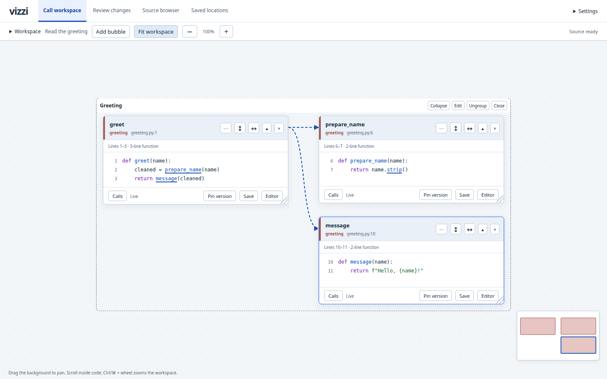

# Vizzi

Vizzi helps you visualize your code, follow a call chain without losing the code you came from, and assist reviews. 

It runs locally beside your editor. Source exploration is read-only; editing, refactoring
and debugging stay in the editor.



## Try it

Vizzi is an early preview built from source. The tested setup is Linux with a recent
Chromium-based browser. You need a current stable Rust toolchain and native C build tools.
Basic browsing does not need Node.js. Optional servers have their own runtime requirements.
See the [installation guide](docs/how-to/install.md).

From a Vizzi checkout:

```sh
cargo build --locked --release -p vizzi
./target/release/vizzi \
  --root /path/to/project \
  --workers 1
```

Open the printed address, normally <http://127.0.0.1:7474/>. Select **Add bubble**, find a
function, and follow a highlighted call. With `vizzi` on your `PATH`, you can run it
without arguments from the project directory. `--root` selects another directory;
`--cache` overrides the automatically chosen [workspace cache](docs/reference/storage.md#cache-location).
Stop the server with Ctrl-C.

For semantic navigation on a real project, [configure its language server](docs/how-to/configure-language-servers.md):
`--pyright pyright-langserver` for Python, `--rust-analyzer rust-analyzer` for Rust,
`--ruby-lsp ruby-lsp` for Ruby, or `--clangd clangd` with C/C++ compilation context.

For a guided first run, follow a [Python](docs/tutorials/python-call-trail.md),
[Rust](docs/tutorials/rust-call-trail.md), [Ruby](docs/tutorials/ruby-call-trail.md)
or [C/C++](docs/tutorials/cpp-call-trail.md)
call trail using the included examples. No project build, language server or editor
integration is required for these lessons.

## What you can do

- Follow calls into neighbouring bubbles, inspect callers and references, and keep branches
  visible. Configured language servers resolve typed receivers, imports and references
  for Python, Rust, Ruby and C/C++.
- Arrange related views into groups and save browser-local tasks. Follow saved file changes
  live or pin an earlier source view.
- Browse source, compare Git revisions or working changes, and keep source locations and
  notes. Hand off a current location to VS Code when you want to work on it.

Rust, Python and Ruby are selected by default. Raw C/C++ browsing uses explicit source scopes.
Language support and call resolution have [important differences](docs/reference/languages.md);
a candidate match is not proof of a runtime call.

## Documentation

- [Documentation home](docs/README.md)
- [Run Vizzi on your project](docs/how-to/run-workspace.md)
- [Configure semantic navigation and local dependency source](docs/how-to/configure-language-servers.md)
- [Review changes](docs/how-to/review-local-changes.md)
- [Troubleshooting](docs/how-to/troubleshoot.md)
- [Changelog](CHANGELOG.md)

[Contributing](CONTRIBUTING.md) covers development and verification. Design contracts,
plans and experiment records are indexed in the [contributor documentation](docs/development/README.md).
