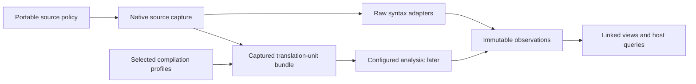

# Why C/C++ needs source policy and compilation contexts

C/C++ support needs to preserve the distinction between source a developer can read
and the program selected by a build. That distinction matters both when learning a
repository without building it and when reviewing a change that affects only some
configurations. The [policy contract](../prototype/C_FAMILY_POLICY.md) defines the
chosen behavior; this explanation describes the evidence and trade-offs.

The proposed flow keeps native input capture outside portable analysis. The configured
branch is later work; both branches produce immutable results for the same views.

## Extensions help discovery, but cannot settle language

The pinned corpora make a global extension-to-parser map unsuitable:

| Corpus | `.c` candidates | C++ source candidates (`.cc`, `.cpp`) | `.h` candidates | `.hpp` candidates | CUDA candidates (`.cu`, `.cuh`) |
| --- | --- | --- | --- | --- | --- |
| Linux | 37,752 | 8 | 27,282 | 0 | 0 |
| PyTorch | 194 | 2,346 | 2,431 | 98 | 431 |
| lpc-rs | 70 | 0 | 16 | 0 | 0 |

These are file candidates, not established language assignments. In lpc-rs,
`tests/fixtures/mudlib/std/room.c` contains LPC constructs, and the `.c`/`.h` candidates
span fixtures, examples, and `ulib`. A rule that enables C everywhere would violate
the project's explicit LPC exclusion. Linux also contains a small amount of C++ in
tools/scripts; repository-wide majority voting would lose that distinction.

The [inventory report](../../experiments/languages/results/c-family-inventory-2026-11-01.json)
records source revisions, byte counts, examples, and content-manifest hashes. The
[reproduction procedure](../../experiments/languages/README.md#inspect-c-family-candidates)
explains the scope. These observations motivate scoped C-family enablement, explicit
exclusions, and source-only ambiguous headers. They are not parsing-accuracy results.

## Raw exploration and configured analysis serve different needs

Raw syntax can provide useful source-backed declarations without generated headers,
SDKs, or a successful build. However, the previous [grammar measurements](../../experiments/performance/SECOND_RESULTS.md)
reported recovery in 32,896 Linux C/header files and 2,079 PyTorch C++/header files.
Those experiments assigned headers to a requested grammar; they did not establish
build-derived language or configuration coverage.

Compiler tools need the environment in which a translation unit is interpreted.
Clangd documents language flags, include paths, macros, target, driver, and working
directory as relevant inputs. It also documents both known-includer and filename
heuristics for obtaining header commands, including the possibility of incorrect
filename inference. [Clangd's compile-command design](https://clangd.llvm.org/design/compile-commands)
is useful evidence for retaining provenance. Vizzi's policy chooses explicit/observed
contexts over automatic basename inference; that is a project decision.

Reading build metadata is also different from reproducing a build. The pinned kernel
contains a generator that collects `.cmd` build records; PyTorch contains a utility
that merges databases and rewrites some driver names for another tool. Vizzi can
eventually import supplied records without running either utility or adopting that
rewrite. The pinned sources are
[Linux's generator](https://github.com/torvalds/linux/blob/cbbddb6b08cc9900a87cccaa9b22bbe06aa4f50a/scripts/clang-tools/gen_compile_commands.py)
and [PyTorch's merge utility](https://github.com/pytorch/pytorch/blob/1f4d2d5e820dd870626dca4f9603e3a49879dbde/tools/merge_compile_commands.py).

CUDA needs its own capability. NVIDIA documents `.cu` inputs as containing host/device
code and supports explicit language selection. Our decision to keep CUDA candidates
source-only preserves that distinction while ordinary C++ extraction is qualified.
It does not assume a C++ grammar is a CUDA analyzer.
[NVIDIA's compiler-driver reference](https://docs.nvidia.com/cuda/cuda-compiler-driver-nvcc/index.html#supported-input-file-suffixes)
provides the underlying language distinction.

## Conditional compilation is more than syntax recovery

Kästner et al., **Variability-Aware Parsing in the Presence of Lexical Macros and
Conditional Compilation** (OOPSLA 2011), introduce TypeChef's variability-aware parsing
approach. Their problem includes retaining conditional alternatives without enumerating
every configuration. [Conference paper record and abstract](https://2011.splashcon.org/details/oopsla-2011-papers/48/Variability-Aware-Parsing-in-the-Presence-of-Lexical-Macros-and-Conditional-Compilati).

Gazzillo and Grimm, **SuperC: Parsing All of C by Taming the Preprocessor** (PLDI 2012),
combine configuration-preserving preprocessing with a parser that forks/merges states
under conditional alternatives. The paper also tracks configuration-sensitive symbol
information: conditionally defined names affect parsing, not just a later display
filter. [Author-hosted paper](https://www.paulgazzillo.com/papers/pldi12.pdf).

These papers support an architectural distinction, not a claim that Vizzi already
performs variability-aware analysis. A raw Tree-sitter walk lacks that machinery.
Parsing two grammars, collecting all visible branches, or accepting an error-free tree
does not demonstrate coverage of all compiled variants. Configured analysis of a
selected profile is useful, but still covers that profile. Adopting a variability-aware
backend would need its own evidence on contemporary C/C++ corpora and resource limits;
the cited research does not establish a current C++ backend choice.

Baum et al., **Understanding Conditional Compilation Through Integrated Representation
of Variability and Source Code** (SPLC 2019), connect feature selection with explorable
source structure. Their prototype connects feature selection, program structure, and
source code to investigate a selected variant. [Paper](https://arxiv.org/pdf/1908.08375).
For Vizzi, this motivates keeping configuration provenance available to future views
and reviews. It does not make a variability visualization an initial feature or prove
that the current overview supports those tasks.

## Keep cheap reuse separate from dependency-aware reuse

The current raw analyzer consumes only captured bytes, so unchanged bytes and the
same analyzer context can safely share path-independent facts. A configured header
can instead depend on its includer's prior macro definitions, include order, target,
and generated inputs. Hashing the header alone loses that environment.

The policy therefore preserves the simple byte-only raw interface and reserves a
separate immutable input-bundle interface for configured work. Source-policy identity
also belongs to the snapshot: adding a supported subtree must force rediscovery even
when all previously captured documents, or an empty snapshot, look unchanged.
These decisions keep invalidation explicit without introducing compiler work into
ordinary raw-source browsing.
