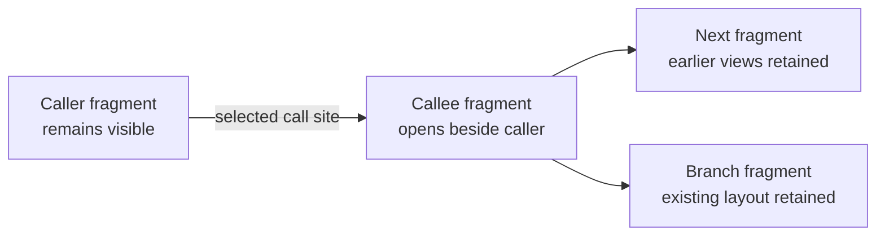

# Preserve the call trail as a visual working set

For contributors designing the next Vizzi interaction. The maintainer's current reference
is Code Bubbles, specifically walking a call chain visually while retaining previous-step
context. This corrects the search/navigation emphasis of the preceding experiments.

## Literature and project inference

[Bragdon et al., CHI 2010](https://andrewbragdon.com/papers/p2503-bragdon.pdf) centres the
interface on concurrently visible source fragments arranged into task working sets on a
pannable plane. Grouping, readable fragment presentation and spatial organisation support
comparing and revisiting related code. Its controlled Java tasks provide evidence for that
interaction style, not general proof for Vizzi's languages, renderer or usability.

The [ICSE 2010 paper](https://cs.brown.edu/people/spr/codebubbles/icsefinal.pdf) extends this
into an IDE-wide working-set model, including other artifacts and interruption recovery.
The author's [navigation documentation](https://cs.brown.edu/people/spr/codebubbles/documentation.html)
explains definition/use expansion and stacks for multiple candidates. The full Code Bubbles
IDE includes editing; Vizzi retains the editor-companion role and borrows the visual
working-set interaction rather than adopting every IDE facility.

**Vizzi design inference:** the task's context belongs in a persistent visual workspace.
Search and source relationships help add a view there. Navigation should expand that
workspace while preserving the existing context. The six-line evidence card, transient
preview and replacing call list do not deliver that interaction.

## The first interaction to demonstrate

Start with a readable function fragment. Selecting a call opens a callee candidate beside
it, visibly connected to the supporting call site. The caller remains in place, at its
reading position. Following another step keeps both earlier views. Opening a branch adds
another view rather than replacing the current step or rearranging the whole chain.

For the already-known Minitosis task, a small working set could include `process`, `render`,
`Processor::process_sample`, and the relevant dry/effect/modulation views. These are example
source locations for a visual prototype, not a fresh search evaluation. Where destination
resolution is uncertain, present that choice and preserve the uncertainty on the link.

Spatial context needs more than a row of nodes: readable source, stable positions,
resizing/moving, a way to recover offscreen context, and deliberate return to an earlier
view without reconstructing the route. Avoid automatic global re-layout as views arrive.
A task overview/minimap and fit controls should help manage larger working sets while
keeping the current/previous fragments readable. Long source must support bounded loading
and useful elision/scrolling instead of silently becoming an unrelated tiny excerpt.

## Multiple coordinated views

Source fragments lead the first prototype. The visual-workspace model must also accommodate
focused relationship/overview views, notes and revision/diff views for review. Selecting an
item in one view can reveal/highlight its counterpart elsewhere while preserving the other
views. Groups can hold a branch/subsystem and later collapse to manage space. Do not require
all representations or a whole-repository graph in the first implementation.

The reader's arrangement is presentation state: positions, groups, camera, selected views
and reading positions. Source identities and analysis relationships remain separate. An
association drawn by a reader is distinct from an analysed call, and a hypothetical target
is distinct from a resolved destination. Per-view revision/version bindings support future
before/after review context without silently retargeting a bubble.

## Scope and next evidence

The next reviewable artifact should be a small interactive visual call-trail prototype,
showing retained caller context and branching on a real, already-known source example.
Validate the layout/interaction with the maintainer before extending search, model work,
semantic resolution or another generic navigation dashboard.

The existing immutable source engine, captured call evidence, bounded source windows and
editor-neutral handoff are supporting infrastructure. A new parser or backend rewrite is
not justified by this direction. Rendering budgets apply to the active working set and
coordinated views; a huge repository need not materialise every fragment on the canvas.
Keep Rust/wgpu versus DOM/canvas choices separate from the visual-workspace model, and
measure representative readable fragments/edges before making a final renderer decision.
