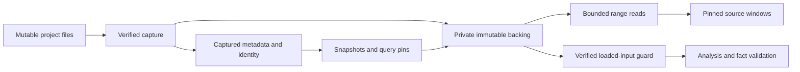

# Bounded reads over immutable captured source

The [ownership investigation](../../experiments/source-storage/RESULTS.md) measures
source/index buffers across unchanged capture, version churn and an external query pin.
Use it to design the next storage interface. The first reader/backing adapters are implemented with resident capture as the default;
opt-in spooling changes body storage while publication retention is unchanged.

## Required behaviour

A captured source pin continues to identify exact verified bytes after project edits,
publication-history expiry and cancellation of later work. Backing lifetime follows
snapshot/query ownership. A valid pin is never silently replaced with current project
contents. If backing cannot be read, return an explicit storage/integrity error rather
than mislabelling it as unsupported encoding or empty source.

Source content identity, byte length, encoding and line positions remain immutable and
independent of path, language, context and source control. Capture must still hash actual
bytes and validate observed length; metadata alone cannot prove reuse. Full-analysis
loads additionally verify their bytes against the captured identity before facts can
be attached. Resource deferral remains separate from source storage/read failures.

## Reader seam

Move whole-file access behind an explicit fallible loading operation. A loaded-input
guard owns or borrows verified bytes for the analyser/cache-validation lifetime and
carries the corresponding resident-input reservation. Facts are validated against that
same loaded input, avoiding a second full read or thousands of tiny storage reads for
range checks. Over-limit analysis can remain deferred while bounded source reads work.

Add fallible bounded range/window access for inspection. It must preserve the existing
UTF-8/CRLF, long-line continuation, byte/line coordinates and snapshot/file/version binding
rules. Summary views, layout and declaration metadata should not load full source.
Bulk diagnostics need explicit loading/streaming limits and errors; `None` text remains
an encoding/projection choice rather than a catch-all for IO or capacity failure.

Keep portable metadata/reader contracts in core and filesystem/storage policy in native
adapters. Start with in-memory and private immutable-backing adapters behind this real
seam. Native backing must not expose writable project files as captured data. Existing
safe IO interfaces are viable; this does not justify adding unsafe memory mappings.

## Limits and storage choices

Resident source buffers, line-index storage, active analysis input, retained syntax,
backing disk space and total process memory are distinct resources. A resident-buffer
budget must account for active readers even after cache eviction. A history-only quota
cannot bound the current source set or independently held query handles. Releasing live
buffers also does not require an allocator to return RSS immediately.

Prototype backing layout separately from the reader contract. Per-source blobs simplify
lifetime/error handling but add file/IO overhead; packed immutable segments reduce file
count but need cancellation cleanup, reclamation and disk-capacity rules. Measure those
trade-offs before choosing the storage engine. Content/chunk sharing may reduce version
cost, but also requires access that does not demand one permanent contiguous string.
Compact/sparse indexes are another independent option, not a complete resident-source cap.

Do not perform range reads or large backing cleanup under the publication metadata lock.
Bound native blocking IO work and preserve existing frontend cancellation/stale-result
handling. Define typed invalid-range, capacity, IO and integrity errors, including how
HTTP/editor adapters surface a retryable failure without mixing versions.

## Validation before switching capture

Use TDD with in-memory and immutable-backing readers. Cover bounded UTF-8 fragments,
empty/unsupported input, long lines, whole-input identity validation, wrong ranges,
capacity refusal, short/corrupt reads, cancellation, source deletion/rewriting, expired
publication with a live query guard, final handle cleanup and concurrent reads. Compare
all returned bytes and source coordinates with the existing implementation.

Then repeat the source-ownership and admission workflows with independent stored-source
checks and constrained child memory. Retain source reachability and explicit errors.
Only after those pass should native capture move from resident whole-file buffers to
the chosen backing. This proposal does not yet enforce a source or whole-process cap.

## Implemented first increment

The [reader reference](../prototype/SOURCE_READS.md) defines verified input guards,
typed failures, bounded integrity-block sessions, metadata-only summary/line access,
source-window preservation and native error handling. In native analysis, the job scope
holds the input permit and loaded guard together, dropping bytes before the permit.
This keeps portable input types independent of native scheduling.

The first private backing is a mutex-serialized anonymous append-only session file.
A configured cumulative disk cap fails capture safely. It has no per-version reclamation
and is not the final durable storage choice. Capture still uses one transient whole-file
read before spooling; metadata/index/integrity and parser/transport memory are separate.
Default capture remains resident. [Validation and measurements](../../experiments/source-reads/RESULTS.md)
compare current-code resident/backed storage and repeat the admitted workflows.
