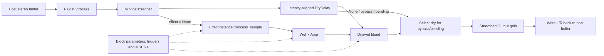

# Source reference for the Tract trial questions

For the maintainer checking the fresh-question search results. This reference was
assembled by reading the frozen source **after** Vizzi's first paired results were saved.
It is an agent-authored source audit, not an answer generated by Vizzi, a model, or an
independent maintainer trial.

The revision is `951cf85413029423e036c641638b845edafe75cf`. Paths below refer to that
revision of `/home/mpd/git-sources/tract-plugin-pack`; the evaluation used its separate
immutable Git export. See [the trial results](TRACT_PLUGIN_PACK_FRESH_RESULTS.md) for
what the unchanged search actually returned.

## GUI widgets currently used

The shared implementation is [tiny-skia-widgets](</home/mpd/git-sources/tract-plugin-pack/tiny-skia-widgets/src/lib.rs:1>).
Editors combine immediate-mode drawing functions with interaction helpers such as
`TextEditState`, `DropdownState` and `MsegEditState`. The common control families have
verified production uses:

| Family | Definition | Example use |
| --- | --- | --- |
| Buttons and toggles, including outline variants | [controls.rs:16](/home/mpd/git-sources/tract-plugin-pack/tiny-skia-widgets/src/controls.rs:16) | [Gain Brain controls](/home/mpd/git-sources/tract-plugin-pack/gain-brain/src/editor.rs:156), [Pope Scope outline controls](/home/mpd/git-sources/tract-plugin-pack/pope-scope/src/controls.rs:97) |
| Horizontal sliders with editable value readouts, including outline variants | [controls.rs:58](/home/mpd/git-sources/tract-plugin-pack/tiny-skia-widgets/src/controls.rs:58) | [GS Meter gain/reference rows](/home/mpd/git-sources/tract-plugin-pack/gs-meter/src/editor.rs:292), [Minitosis Output](/home/mpd/git-sources/tract-plugin-pack/minitosis/src/editor.rs:147) |
| Segmented/stepped selectors, including outline variants | [controls.rs:142](/home/mpd/git-sources/tract-plugin-pack/tiny-skia-widgets/src/controls.rs:142) | [Gain Brain link mode](/home/mpd/git-sources/tract-plugin-pack/gain-brain/src/editor.rs:239), [Pope Scope display choices](/home/mpd/git-sources/tract-plugin-pack/pope-scope/src/editor.rs:1003) |
| Rotary parameter dials with value editing, modulation arcs and dimmed variants | [param_dial.rs:136](/home/mpd/git-sources/tract-plugin-pack/tiny-skia-widgets/src/param_dial.rs:136) | [Gain Brain gain](/home/mpd/git-sources/tract-plugin-pack/gain-brain/src/editor.rs:310), [HD26 dimmed dials](/home/mpd/git-sources/tract-plugin-pack/hd26/src/editor.rs:216) |
| Dropdown triggers and popup lists | [dropdown.rs:400](/home/mpd/git-sources/tract-plugin-pack/tiny-skia-widgets/src/dropdown.rs:400), [popup:450](/home/mpd/git-sources/tract-plugin-pack/tiny-skia-widgets/src/dropdown.rs:450) | [Tinylimit preset selector](/home/mpd/git-sources/tract-plugin-pack/tinylimit/src/editor.rs:608), [effect picker](/home/mpd/git-sources/tract-plugin-pack/tract-effects/src/editor/view.rs:366) |
| Numeric/text-entry state used by parameter controls | [text_edit.rs:12](/home/mpd/git-sources/tract-plugin-pack/tiny-skia-widgets/src/text_edit.rs:12) | [Gain Brain editor state](/home/mpd/git-sources/tract-plugin-pack/gain-brain/src/editor.rs:63) |
| MSEG curve editing, nodes/handles, menus and randomization | [editor state](/home/mpd/git-sources/tract-plugin-pack/tiny-skia-widgets/src/mseg/editor.rs:96), [drawing](/home/mpd/git-sources/tract-plugin-pack/tiny-skia-widgets/src/mseg/render.rs:109) | [Miff curve view](/home/mpd/git-sources/tract-plugin-pack/miff/src/editor.rs:253) |
| Shared composite effect/MSEG editor | [EffectEditor](/home/mpd/git-sources/tract-plugin-pack/tract-effects/src/editor/mod.rs:69) | [Minitosis composition](/home/mpd/git-sources/tract-plugin-pack/minitosis/src/editor.rs:108) |

Individual plugins also draw specialized views: meters, waveforms and cursor tooltips,
spectrum/EQ curves, stereo visualizations, wavetable/filter-response views and the
Multosis sequencer grid. For example, [Pope Scope's waveform renderer](/home/mpd/git-sources/tract-plugin-pack/pope-scope/src/renderer.rs:399)
is custom drawing rather than a shared slider-style control. The eight families above
are a useful shared-control inventory, not a census of every custom view or widget instance.

Two distinctions matter for “used”: the exported `grid_selector` implementation has no
production call sites outside its own crate in the audited revision, and the old
`nih-plug-widgets` Vizia crate is explicitly [excluded from the workspace](/home/mpd/git-sources/tract-plugin-pack/Cargo.toml:7).
Listing every widget-looking declaration would therefore overstate the current inventory.
These are static source findings; the inspected project was not built or executed.

## Minitosis input-to-output path

The local entry point is [Plugin::process](/home/mpd/git-sources/tract-plugin-pack/minitosis/src/lib.rs:255).
The plugin declares stereo input/output. `process` reads transport state, uses 120 BPM
when the supplied tempo is absent/invalid, checks for two channels, and passes their
mutable slices to [Minitosis::render](/home/mpd/git-sources/tract-plugin-pack/minitosis/src/lib.rs:110).
External nih-plug host/device plumbing is outside this repository export.

The precise ordering and branches are:

1. **Choose/prepare the active processor.** `render` compares the requested effect,
   selection generation and sample rate with the active processor. It installs a ready
   replacement through [ProcessorHandoff::try_install](/home/mpd/git-sources/tract-plugin-pack/minitosis/src/handoff.rs:31)
   or requests [background preparation](/home/mpd/git-sources/tract-plugin-pack/minitosis/src/lib.rs:49).
   Pending replacement forces dry output while the old processor continues running.
2. **Apply block controls and modulation.** After optional modulation recall/reset,
   [Processor::begin_block](/home/mpd/git-sources/tract-plugin-pack/minitosis/src/engine.rs:70)
   sets BPM/base effect parameters, scans input for configured triggers, advances the
   four MSEGs and applies effective parameters/Mix. It refreshes the effect latency,
   which `render` reports to the host when changed. The shared logic is
   [ModulationState::begin_block](/home/mpd/git-sources/tract-plugin-pack/tract-effects/src/modulation.rs:528)
   and [advance_segment](/home/mpd/git-sources/tract-plugin-pack/tract-effects/src/modulation.rs:560).
3. **Process each stereo sample.** [Processor::process_sample](/home/mpd/git-sources/tract-plugin-pack/minitosis/src/engine.rs:89)
   first gets latency-aligned dry audio from [DryDelay::next](/home/mpd/git-sources/tract-plugin-pack/minitosis/src/engine.rs:31).
   `None` returns that dry sample immediately. Otherwise,
   [EffectInstance's dispatch](/home/mpd/git-sources/tract-plugin-pack/tract-effects/src/effects/mod.rs:1237)
   invokes the selected effect implementation. The effective Mix comes from
   [next_mix](/home/mpd/git-sources/tract-plugin-pack/tract-effects/src/modulation.rs:623),
   clamped to `[0, 1]`.
4. **Resolve bypass and blend.** Bypass/pending returns aligned dry audio after effect
   processing, preserving running DSP state. The normal branch computes each channel as
   `dry × (1 − mix) + wet × amp × mix`. Amp affects the wet contribution, not dry audio.
5. **Apply Output and write back.** [render's output stage](/home/mpd/git-sources/tract-plugin-pack/minitosis/src/lib.rs:172)
   applies smoothed Output gain and writes both channels back in place. Explicit Bypass
   forces unity Output gain; a pending switch alone does not. The local variable named
   `wet` here already contains the processor's blend/dry result, rather than a pure wet bus.

This is a source-backed overview of the generic path. The selected effect adds its own
DSP internals. Minitosis runs one effect; importing Multosis's sequencer or wet-bus
compressor into this explanation would describe the wrong plugin.
