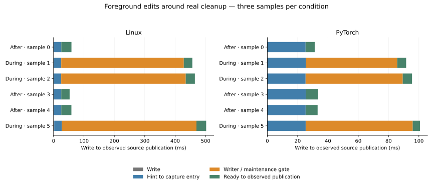

# Foreground edits wait for allocation state during cleanup

Ordinary source publication is delayed by the remaining tail truncation even though
pinned reads are isolated. In these controlled Linux/PyTorch samples, median write-to-
observed-publication latency rises from **58.8 / 33.2 ms after cleanup to 464.8 / 95.5 ms
during cleanup**. Median writer/initial-maintenance gate time is **409.5 / 64.1 ms**.
Every requested overlap condition actually enters capture before truncation finishes.

This stage measures the existing behaviour; it does not change production scheduling,
retention or quotas. Qualification-only trace/observer code is absent from default builds.
No dependencies or unsafe code were added. The [procedure](README.md) reproduces the
workload and the [design](../../docs/plans/foreground-maintenance.md) records its protocol.

## Where the edit spends its time

The four plotted components exactly sum to observed edit latency. Hint-to-capture entry
includes host debounce, coordinator work and path preparation. The gate covers writer
acquisition and initial maintenance. Ready-to-publication includes later source IO,
analysis/cache work, snapshot merge, publication and polling uncertainty.

| Observation, three samples per condition | Linux | PyTorch |
| --- | --- | --- |
| After-cleanup publication, median (range) | 58.8 ms (52.9–58.9) | 33.2 ms (31.3–33.5) |
| During-cleanup publication, median (range) | **464.8 ms (456.5–501.9)** | **95.5 ms (91.6–100.7)** |
| During-cleanup gate, median (range) | **409.5 ms (403.0–442.5)** | **64.1 ms (60.3–70.6)** |
| During-cleanup truncation, median (range) | 434.8 ms (428.5–470.1) | 89.4 ms (85.8–96.0) |
| Hint-to-capture entry, all samples | 25.1–25.4 ms | 25.2–25.3 ms |
| Analysis/cache/merge after capture, all samples | 26.7–32.3 ms | 4.0–7.3 ms |
| Overlapping captures / requested overlap samples | 3 / 3 | 3 / 3 |
| Parsed files per edit | 1 | 1 |
| Sampled process peak RSS | 2.824 GiB | 0.504 GiB |

Control gates round below 0.01 ms. File writes take about 0.1 ms except one Linux sample
at 2.3 ms. Capture itself takes 403–443 / 60–71 ms during cleanup, almost entirely the
gate; other capture work stays below about 0.3 ms. Post-capture analysis/merge remains
broadly similar across conditions. The approximately 25 ms host debounce is visible in
both conditions and does not account for the extra cleanup delay.

The shared allocation state is the bottleneck in this workload. The cleanup observer
notifies while that state is held, the edit is hinted through the normal host path, and
capture readiness occurs only after actual `set_len` finishes. Backing space remains
available: peak reserved spans are about 5.393 / 0.923 GiB within 8 / 1 GiB allowances.
Increasing parser workers or disk allowance would not remove this particular lock wait.

## Workload and correctness

The probe runs the real Host/Engine/invalidation/Application path on marked owned copies
of the pinned 66,066-file Linux and 10,578-file PyTorch scopes. Targets are
`kernel/locking/mutex.c` and `c10/core/Device.cpp`. Compatible facts are prepared before
timing. Initial verification completes before samples; an hour-long periodic interval,
native watching disabled and explicit path hints isolate later cleanup contention.
There is no syntax retention or input-admission quota in this workload.

Each sample first streams a generated tail outside project source into the shared spool:
4 GiB Linux / 768 MiB PyTorch. That setup is untimed. A worker retires the tail and reports
actual truncation entry/finish on the same monotonic clock as capture/write/publication.
The control waits for completion before editing; the overlap case writes immediately
after notification. Condition order alternates across three pairs. No delay is inserted
into real truncation, and all requested overlaps are verified from recorded intervals.

The tail is a controlled pressure fixture, not typical repository code or a measurement
of how often real publication history retires such tails. Staging also truncates during
untimed pressure setup; the reported cleanup interval refers to the committed backing.

Every edit adds a unique declaration and parses one file. Published bytes, the expected
declaration, facts from an independent fresh analyser and the retained old pin all match.
The original file and baseline observation are restored between samples. Final complete
clean observations agree and backing allocation/file lengths return to zero while stores
remain open. Original archives are untouched and target SHA-256 hashes are restored.

The i7-13700H host exposes 20 logical CPUs and about 62.5 GiB RAM, with Rust 1.99.1.
No builds, tests, mutation jobs, cache preparation or other benchmarks compete during
timing. OS caches are warm. The 12 GiB child address-space limit is not an RSS/physical-RAM
limit or baseline-laptop qualification. Process peaks include pressure generation and
independent source/fact verification; those operations are outside edit latency.

Publication is observed by roughly 2 ms polling. The native hint path includes the host's
25 ms debounce; filesystem notification delivery, HTTP, browser presentation, retained
syntax and competing periodic recovery are not measured. Three samples per condition
are finite observations, not latency tails, randomised speedups or a default-policy decision.
This does not qualify cold-storage behaviour or other platform/filesystem performance.

## Verification and mutation evidence

The first integration test fails before the probe module exists. Tests cover real host
publication/restoration, 16 alternating sample cases at the parameter boundary, timing
ordering/unit consistency, wrong/empty ownership markers and invalid budgets/counts.
Protocol tests reject missing/duplicate/reversed capture marks, incomplete recovery,
pending work, wrong source/facts/declaration/old pin and wrong/empty tail data. Generated
declarations parse as syntax in Rust, Python, C and C++. A paused real cut verifies that
capture trace spans the gate; trace storage is bounded to 64 records and can be disabled.

Formatting, **268 Rust tests**, doctests, Clippy and **58 Node/browser checks** pass.
Full affected spool and new probe scopes yield **160 final unique mutation outcomes:
118 caught by tests, 32 unviable, ten timeouts, zero survivors**. Passing unmodified
baselines precede interpretation. Initial survivors led to negative protocol fixtures,
language coverage, readiness/settling truth tables and explicit timing-unit checks.
A redundant timeout-edge comparison was replaced by a testable remaining-budget wait.
Final complete helpers/protocol functions replace superseded outcomes without duplication.

No new exclusions were added; existing unrelated engine directory-prefix configuration
is unchanged. Timeouts break input/copy or expected-publication progress and are separate
from assertion catches. Unviable substitutions fail compilation/build. Portable source,
allocator, engine/host scheduling, macro bodies, Python, dependencies and OS/browser
internals are unchanged or outside mutation scope. Evidence is not proof of correctness.

## Next architectural question

Foreground capture needs a safe path independent of a file undergoing physical cleanup.
Simply unlocking state around truncation risks cutting off new reservations. The next
design should compare bounded active storage separate from cleaning files with explicit
foreground capture admission, preserving immutable pins and aggregate disk/memory bounds.
Physical cleanup remains non-preemptible; moving it to another thread alone does not
remove the allocation dependency. No scheduling/storage fix is claimed in this report.
The subsequent [independent capture stage](../independent-capture/RESULTS.md) implements
two fixed backing files with aggregate charging and compares both backends.

[Raw observations](results/observations.json), [summary](results/summary.json),
[sample CSV](results/samples.csv), [cache preparation](results/preparation.json),
[mutation details](results/native-mutation.json) and [source hashes](results/source-sha256.json)
preserve workload, code, binary and validation identity. Regenerate the figure with
`MPLCONFIGDIR=/tmp/vizzi-foreground-matplotlib python3 experiments/foreground-maintenance/plot.py`.
