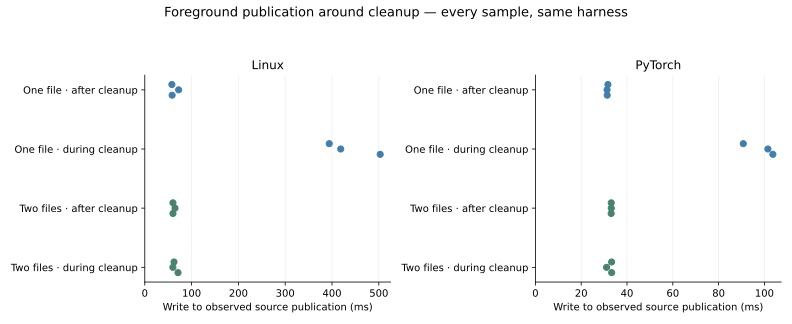

# Foreground capture uses backing independent of physical cleanup

The spool now has two fixed backing files under one aggregate quota. A cleaning file
is unavailable for new allocation while captures use the other. During the controlled
cleanup workload, median source publication falls from **418.6 to 62.4 ms Linux** and
**101.5 to 33.3 ms PyTorch**. All six current-backend edits publish before the observed
truncation finishes, and their bytes/facts/old pins still verify afterward.

This implements the storage seam identified by the
[foreground report](../foreground-maintenance/RESULTS.md). The
[design](../../docs/plans/independent-capture.md) records alternatives and safety rules;
the [reference](../../docs/prototype/SOURCE_READS.md) defines accounting and maintenance.
No unsafe code, new dependency, resident-memory bypass or production background worker
was added. Resident capture remains default; private spooling remains opt-in.

## Ownership and aggregate admission

Each descriptor retains a stable file index and extent. Live bytes never relocate.
Two cursor/maintenance handle pairs plus staging use five handles per spool, independent
of repository file count. Reads remain protected by their file's cursor lock.

Explicit maintenance serializes physical work, marks one file unavailable under global
state, snapshots its safe cut, then releases global state for metadata/truncation. Existing
reservations stay within that cut; no new reservation can enter the cleaning file.
Completion restores availability. Charge falls only after physical cleanup succeeds.
Failure or unwind restores availability while preserving the old charge for retry.

Aggregate charged spans of both files remain within the configured quota, including
in-flight reservations and the full pre-cleanup charge of a cleaning file. Captures need
headroom or usable charged space in the available file. Without a contiguous fit they
return capacity refusal rather than wait for physical cleanup; the last published source
remains readable. This is not guaranteed progress with all capacity retained by pins.

Capture/commit drains retirement metadata without truncating. Freed ranges and retired
tails in an available file can be overwritten within their existing charge. Failed or
cancelled copies return logical allocation before returning; physical space stays charged
until reused or explicitly cleaned. File lengths can remain at a previous high-water mark
until `reclaim` or final closure. No idle/background maintenance schedule is introduced.

## Foreground comparison

Both implementations use the identical updated qualified harness. The baseline backend
is `93d5632`, built in an isolated target; source and distinct binary hashes are checked
before timing. The harness permits readiness/publication before cleanup ends and retains
mandatory post-cleanup byte/fact/pin verification. Old scheduling, watchers and parser
worker settings are otherwise unchanged.

| Publication observation, median (range) | Linux one file / two files | PyTorch one file / two files |
| --- | --- | --- |
| After cleanup | 58.4 (57.9–72.3) / 60.2 (60.2–64.5) ms | 31.3 (31.3–31.7) / 33.1 (33.1–33.1) ms |
| During cleanup | **418.6 (394.1–502.9) / 62.4 (60.0–71.0) ms** | **101.5 (90.8–103.7) / 33.3 (31.1–33.3) ms** |
| During-cleanup writer/initial-maintenance gate | 357.2 / below 0.01 ms | 69.7 / below 0.01 ms |
| Requested capture overlaps observed | 3 / 3 | 3 / 3 |
| Publications before observed truncation finishes | **0 / 3** | **0 / 3** |
| Sampled process peak RSS | 2.824 / 2.824 GiB | 0.500 / 0.498 GiB |
| Final aggregate allocation/file length | 0 / 0 | 0 / 0 |

Control and during-cleanup timings now occupy similar ranges. Physical cleanup still
takes substantial time; the source publication no longer depends on its completion in
these samples. The result is not a claim that cleanup itself or parsing became faster.

Each repository runs three alternating condition pairs with four parser workers, native
watching disabled, explicit path hints and no syntax-retention/input quota. Initial
verification completes before an hour-long recovery interval isolates later cleanup.
Each edit adds a unique declaration, reopens/parses one ordinary file, verifies fresh
facts and old source, and restores the original observation. Both conditions prepare
the same generated tail outside project source: 4 GiB Linux / 768 MiB PyTorch. That tail
is controlled allocation pressure, not typical repository code or a retired-tail frequency
distribution. No artificial delay is inserted into real truncation.

The shared 8 / 1 GiB backing allowances retain the old cleaning charge while admitting
the new source elsewhere. Staging has a separate equal bound. Source counts, original
target hashes and cumulative writes agree across implementations. All source/fact/pin/
restoration checks pass; independent final clean observations match. Original archives
remain read-only and only marked owned copies are edited.

## Source-history capacity replay

The full history workflow repeats the pinned 66,066-file Linux and 10,578-file PyTorch
scopes, retaining an expired baseline query pin across four whole-scope changed generations.
Restoration, source manifests, old-byte checks, handle expiry and final cleanup pass.

| History observation | Linux | PyTorch |
| --- | --- | --- |
| Aggregate backing allowance | 8 GiB | 1 GiB |
| Peak aggregate charge | 7.006 GiB | 0.873 GiB |
| Cumulative committed bytes | 9.018 GB | 1.124 GB |
| Final total backing length while store remains open | **0** | **0** |
| Sampled process peak RSS | 2.268 GiB | 0.308 GiB |

The limit is shared between files, not multiplied by file count. Free charged bytes may
belong to a cleaning file and be temporarily unavailable. Diagnostics expose cleaning
file count/charge; actual file lengths are observational, not an admission transaction.
File lengths differ from filesystem block allocation and process memory.

## Verification and mutation evidence

The first paused-cleanup capture test fails on the old backend. It passes when capture
completes before cleanup is released, and post-cut byte checks remain correct. Tests cover
both file indexes, full aggregate capacity refusal before cleanup earns credit, successful
credit, errors/retry/unwind, pins, reservations, logical rollback, empty inputs, repeated
rotation and final zero file lengths. An independent occupancy/physical-charge model checks
16,000 mixed operations, alongside the existing independent extent model.

Formatting, **275 Rust tests**, doctests, Clippy and **58 Node/browser checks** pass;
default-feature workspace checks also pass. Full affected spool, pool and extent mutation
scopes yield **154 final unique outcomes: 115 caught by tests, 31 unviable, eight timeouts,
zero survivors**. Passing unmodified baselines precede interpretation. One initial survivor
prompted an explicit success-path charge assertion; its exact rerun replaces that outcome
without double-counting. No new exclusions were added.

The existing unrelated engine directory-prefix configuration is unchanged. Timeouts break
input/copy progress and are separate from assertion catches; unviable substitutions fail
compilation/build. The measurement protocol removes only the superseded requirement that
readiness follow cleanup completion; timing, source, fact and restoration tests remain.
Portable source/host logic, Python, dependency and OS/browser internals are unchanged or
outside mutation scope. Passing evidence is not proof of correctness.

## Limits and next qualification

The i7-13700H host exposes 20 logical CPUs and about 62.5 GiB RAM, with Rust 1.99.1.
No competing builds, tests, mutation jobs, preparation or benchmarks run during timing.
Compatible fact caches and OS caches are warm. The baseline runs first, followed by the
current implementation. Three samples per condition are not randomised trials or latency
tails. The 12 GiB child virtual-address-space limit is not RSS/physical-RAM enforcement
or baseline-laptop qualification. Peaks include pressure setup and independent verification.

The OS/filesystem, retirement metadata batches, another capture holding staging and full
capacity can still delay/refuse work. Physical cleanup is synchronous and serialized for
explicit callers. Compaction, foreground headroom policy, metadata/queue memory, automatic
idle maintenance and full process budgets remain open. HTTP/browser presentation, native
watcher latency, cold storage and competing recovery are not qualified here. Broader real
interactive workflows and baseline hardware are needed before changing defaults.

[Raw comparison](results/observations.json), [summary](results/summary.json),
[sample CSV](results/samples.csv), [history replay](results/history.json),
[mutation details](results/native-mutation.json) and [source hashes](results/source-sha256.json)
retain code, binary, workload and validation identity.
