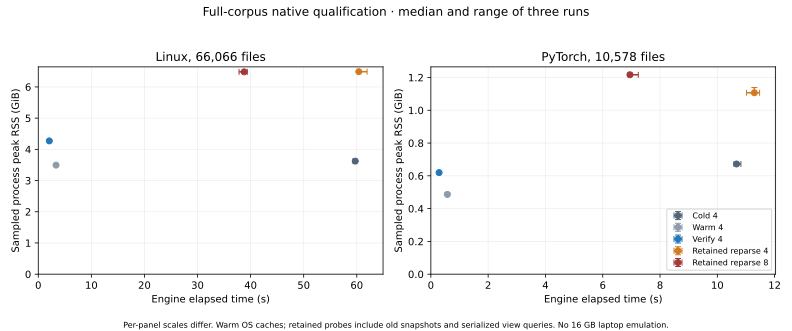

# Full-repository resource qualification

This is the initial qualification record. The [responsiveness follow-up](RESPONSIVENESS_RESULTS.md)
implements bounded outlines and cheaper compatible edits, with new measurements and
remaining limitations. The failures below describe the implementation measured here.

Full Linux/PyTorch runs preserve coherent snapshots and bounded map motion, but do
**not** establish that all interactions meet the project's performance goal. Two
important failures are now measured: Linux small edits still pay work proportional
to the full snapshot, and a large C++ file builds an unbounded declaration outline.
The latter causes a main-thread stall exceeding a second.

## Scope and method

Runs use pinned Linux `cbbddb6b08cc9900a87cccaa9b22bbe06aa4f50a` and PyTorch
`1f4d2d5e820dd870626dca4f9603e3a49879dbde` archives, with the exact raw assignments
in [profiles.json](profiles.json). Linux headers receive a declared C assignment,
with eight C++ source overrides and three shell `.inc` exclusions. PyTorch headers
receive a declared C++ assignment, with 194 C source overrides. These are grammar
inputs, not inferred build configurations. CUDA remains source-only; no project is built.

Independent path/size/content inventories agree with captured counts and bytes:

| Profile | Captured files | With analysis | Source-only | Source bytes |
| --- | --- | --- | --- | --- |
| Linux | 66,066 | 66,066 | 0 | 1,495,484,792 |
| PyTorch | 10,578 | 10,147 | 431 | 186,092,681 |

Linux also includes 568 Rust and 454 Python files; PyTorch includes 5,077 Python files.
Macro/conditional recovery and the selected raw header language do not establish
compiler accuracy, active configurations, or cross-language resolution.

Native conditions have three samples each, warm OS caches, and no concurrent benchmark,
build, test, or mutation jobs. The i7-13700H host exposes 20 logical CPUs and about
62.5 GiB RAM. CPU affinity was unrestricted within those CPUs; power settings and other
system activity were uncontrolled. Cgroup resource limits were not exposed. The host
does not emulate the target 16 GB laptop.

## Native time and retained memory

Times below are median engine elapsed seconds. Memory is the maximum sampled process
RSS across the three runs, in GiB. Source capture and result construction are included;
process startup and teardown are outside engine timing. Cold means an empty analysis
cache, not cold disk.

| Condition | Workers | Linux seconds | Linux peak GiB | PyTorch seconds | PyTorch peak GiB |
| --- | --- | --- | --- | --- | --- |
| Cold indexing | 4 | 59.715 | 3.623 | 10.672 | 0.676 |
| Fresh-process persisted cache | 4 | 3.346 | 3.495 | 0.577 | 0.498 |
| Complete verification with old snapshot retained | 4 | 2.076 | 4.270 | 0.287 | 0.620 |
| Full reparse with old snapshot retained | 4 | 60.385 | 6.488 | 11.293 | 1.139 |
| Full reparse with old snapshot retained | 8 | 38.776 | 6.492 | 6.950 | 1.228 |

Reparse is a controlled analyzer-context revision: actual grammars parse again while
the previous immutable snapshot remains alive. Sources are unchanged. Source-only
inputs can still reuse their documents. A fresh phase cache prevents accidental warm
reuse. Snapshot identities agree across samples, worker counts, and regular cache
states; reparse identities agree with each other and differ from the baseline.

Eight workers improved retained reparse throughput about 1.56× for Linux and 1.63× for
PyTorch relative to four. Linux peak memory did not materially improve; PyTorch peak
increased. This is throughput evidence on this CPU, not justification for always
spending eight workers during interactive use.

The controlled main thread queries/serializes a bounded 2,000-tile view during work.
The largest per-run query p95 was 44.44 ms at four-worker Linux reparse and 52.58 ms
at eight workers. PyTorch values were 10.38 and 11.44 ms. These omit HTTP, browser
decoding, painting, and presentation. They do include intentional query contention.

Cancellation was requested after an observed parse start plus 100 ms, at the query
loop's cadence. The largest request-to-phase-completion observation was **0.845 s**
for Linux and **2.265 s** for PyTorch. Obsolete results did not publish and pinned
source stayed consistent. Parsing remains interruptible only between files, so
correct cancellation does not imply prompt cancellation of a large parse.

Memory is sampled approximately every 50 ms; phase peaks are lower bounds, and VmHWM
is process-lifetime high water. The measurements do not impose a memory cap. The
[summary/CSV](results/native-summary.json), [tabular export](results/native-summary.csv),
[full observations](results/native-observations.json), and
[5,017 query observations](results/native-query-samples.csv) preserve provenance,
samples, phase events, inputs, and limits. The controlled probe omits watcher scheduling;
the following production-host runs retain it.

## Live source and header edits

Live probes use the real watcher/coordinator, seeded caches, atomic writes to disposable
copies, and three edits per selected file. Every resulting snapshot agrees with a
separate complete capture with identical policy arguments. Large-header cases select
the file rather than asserting continuity of an ambiguous declaration identity.

| File case | Engine attempt | Write to coherent stdio response | Observed capture |
| --- | --- | --- | --- |
| Linux `kernel/locking/mutex.c` | 127.5–152.6 ms | 210.4–261.9 ms | One read/parse |
| Linux 24.0 MB generated AMD header | 852.1–2,607.7 ms | 1,105.5–3,369.8 ms | Two targeted attempts; one complete reconciliation |
| PyTorch `c10/core/Device.cpp` | 22.3–25.8 ms | 63.5–80.3 ms | One read/parse |
| PyTorch 8.4 MB Perfetto header | 1,756.2–1,860.7 ms | 2,052.4–2,133.3 ms | One read/parse |

Linux's ordinary edit capture phase alone took 56.4–71.9 ms. Source inspection shows
that hint validation reclassifies/checks every baseline document, and retained-document
selection/snapshot construction also scales with repository size. The data does not
attribute all remaining time to one function. One-file I/O is preserved, but does not
yet make update CPU work proportional to one file.

Periodic two-second full recovery remains active. It can dominate a dirty-path hint,
and later no-op metadata can replace earlier measurements for the same snapshot.
Consequently, metadata sampled after a visible update is not automatically the parse
that caused it. Source/snapshot checks remain authoritative. Stdio timings include
envelope serialization and Python decoding, not browser presentation. See
[live-edits.json](results/live-edits.json).

## Browser interaction and the large-outline failure

Headless Chromium 156.0.8078.4 uses the Canvas2D reference view, software graphics,
and a 1440×900 viewport. Each profile has three four-second steady runs and three
four-second runs with edits to its three largest assigned files. Periodic recovery
is active in both conditions. Trusted pan/zoom input targets 60 Hz with bounded
in-flight submissions; status samples classify observed pending work.

All steady/refresh runs had a **16.8 ms rAF p99**, no intervals over 50 ms, readable
labels, and draw CPU p99 no greater than 0.7 ms. This covers bounded overview motion,
not all file navigation. Slow source selection did not disappear from the report:

| Browser case | Linux | PyTorch |
| --- | --- | --- |
| Five ordinary edit observations, median / maximum | 268.8 / 2,154.6 ms | 130.4 / 151.9 ms |
| Largest-header opening | 223.5 ms | 1,848.8 ms |
| Largest-header edit to DOM plus two rAF callbacks | 1,263.3 ms | 3,326.8 ms |
| Largest-header outline buttons | 0 | **42,443** |
| Rendered source lines | 58 | 56 |
| Largest opening rAF interval | 50.0 ms | **1,599.9 ms** |

The source inspector virtualizes lines; the declaration outline creates every button.
The Perfetto opening includes a 1,556.8 ms long animation frame (1,505.8 ms blocking).
Its edit produces another 1,288.3 ms long frame. This is a material large-codebase
failure, despite smooth overview motion and consistent source data.

Native lifetime high water in these browser runs was 4.555 GiB for Linux and 1.201 GiB
for PyTorch. Renderer heap observations were 67.3 and 58.1 MiB; these are point-in-time
heap values, not peak browser-process-tree RSS. Both final indexes matched complete
captures and browser errors were empty. Reports retain raw frame/input observations,
heap/process metadata, and screenshots:
[Linux](results/browser-linux.json), [PyTorch](results/browser-pytorch.json).

rAF and DOM observations are not GPU completion or physical presentation measurements.
Five edit samples do not establish a latency tail; the displayed maximum must not be
treated as a reliable p95 estimate. No new headed/GPU or baseline-laptop claim is made.

## Measurement-tool validation and next work

The optional qualification feature uses public native interfaces and does not change
production analyzers. New fixture tests first failed against an unimplemented probe.
They now verify retained publication, cache/context reparse, cancellation, timer units
and boundaries, explicit file selection, inconsistent-query rejection, and public JSON
entry/configuration errors. Formatting, **135 Rust tests**, doctests, Clippy, and
**33 Node/browser checks** pass.

After investigating preliminary gaps, the final instrumentation mutation run tested
**39 mutations: 34 caught, five unviable, zero survivors/timeouts, no exclusions**.
[probe-mutation.json](results/probe-mutation.json) separates preliminary/incomplete
attempts from the final passing baseline. This scope qualifies instrumentation logic;
production analyzer mutation evidence remains in the earlier adapter report.

The next [engineering budgets](../../docs/performance/BUDGETS.md) are proposals informed
by these results, not retroactively declared acceptance criteria. Prioritize bounded
outline work, cheap compatible-snapshot validation, prompt/bounded parsing, and source
memory sharing before adding compiler-context features. Full-host resource collection
is complete; large-outline/latency failures and actual 16 GB/GPU qualification remain open.
