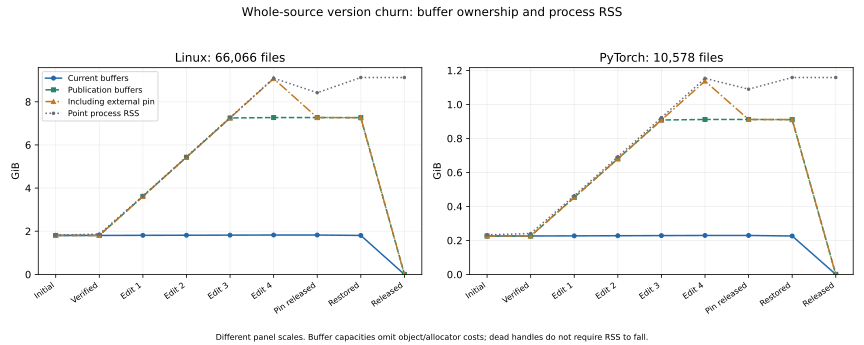

# Captured source, history and external query ownership

Linux's source/index buffers occupy about **1.805 GiB for one captured source set**.
Four rounds that change every source file retain **7.268 GiB** in the normal current-plus-
three-history publication set. An expired baseline query handle adds another
**1.805 GiB**, reaching **9.073 GiB of owned buffer capacity**. This source-storage-only
stress run has a 9.125 GiB sampled RSS peak, without parsers, facts or syntax retention.

Churn across three targeted large files has much smaller history costs: about 1.982 GiB in
Linux publication state, or 2.041 GiB with the external pin. Unchanged capture reuses
all source allocations. These distinctions matter more than summing snapshot sizes or
assuming an expired publication identity releases independently held data.

The outcome is an accounting interface, controlled evidence, and a
[bounded-reader proposal](../../docs/plans/bounded-source-reads.md). Current source
representation, hashing, publication retention, source windows and defaults remain
unchanged. This stage does not implement a source-memory or whole-process cap.

## Method and scope

The [procedure](README.md) makes marked disposable copies of the same pinned
Linux/PyTorch profiles used in earlier experiments. Each profile runs separate
three-file (`headers`) and whole-source (`workspace`) conditions. The three-file set
includes PyTorch C++ sources as well as its Perfetto header. Original archives remain
unchanged; no analysed project is executed or built.

Each condition captures a baseline, verifies unchanged capture, prepends four distinct
version markers to its selected files, releases an externally held initial snapshot,
restores original bytes, then releases publication. There are **four conditions and
36 ownership phases**. Source-only storage snapshots intentionally omit analyses and
a verified engine capture-plan marker while preserving source classification. They are
not end-to-end indexing, analysis-admission or browser benchmarks.

Ownership inventories use actual `Arc<CapturedSource>` identity. Equal-content buffers
that were allocated separately count separately; reused handles count once across
snapshots. The [accounting reference](../../docs/prototype/CAPTURED_SOURCE.md) reports
source byte length/capacity and line-index entries/capacity/bytes without copying,
hashing or touching stored data.

These values describe requested byte/string and index-buffer capacities. They exclude
structs, Arc headers, document metadata, facts, parser state, allocator overhead and
other process allocations. Unused capacity need not occupy resident pages. They are
not exact RSS measurements or a heap-allocation proof.

The i7-13700H host exposes 20 logical CPUs and about 62.5 GiB RAM, using Rust 1.99.1
with 64-bit `usize`. Runs are sequential with warm OS caches and no competing builds,
tests, mutation jobs or benchmarks. Each child has a 12 GiB `RLIMIT_AS` address-space
limit to accommodate the deliberately retained versions. That is not an RSS/physical
RAM limit or a qualification of the 16 GB laptop.

## Current buffers and index costs

| Baseline ownership | Linux | PyTorch |
| --- | --- | --- |
| Captured source files | 66,066 | 10,578 |
| Logical source bytes | 1,495,484,792 | 186,092,681 |
| Byte-buffer capacity | 1.393 GiB | 0.173 GiB |
| Line-index capacity | 0.412 GiB | 0.053 GiB |
| Combined buffer capacity | 1.805 GiB | 0.226 GiB |
| Stored index entries | 38,615,813 | 4,961,396 |
| Allocated index-entry capacity | 55,312,868 | 7,062,829 |

The current indexes use native-width offsets and have capacity beyond their used length.
They account for roughly 23% of these buffer totals. Compact/sparse indexes merit their
own evaluation, but removing index overhead would still leave full source bytes and
version ownership. It would not establish a resident-source cap.

Unchanged full capture shares all 66,066/10,578 sources and leaves current and retained
buffer inventories identical to baseline. It still reopens and hashes the actual bytes.
Observed unchanged capture is 1,472/184 ms in the targeted conditions and 1,222/191 ms
in the whole-source conditions. These single-run timings include source binding and
snapshot construction, without analysis; they are not cold-start application times.

## Publication history and external handles

After the fourth changed version, publication keeps the current observation and three
previous observations. The initial identity has expired from lookup, but the independent
initial query handle still owns its captured data.

| Fourth-version ownership | Linux selected files | Linux whole source | PyTorch selected files | PyTorch whole source |
| --- | --- | --- | --- | --- |
| Current source/index buffers | 1.805 GiB | 1.824 GiB | 0.226 GiB | 0.229 GiB |
| Publication unique source/index buffers | 1.982 GiB | 7.268 GiB | 0.275 GiB | 0.911 GiB |
| Including expired external query handle | 2.041 GiB | 9.073 GiB | 0.291 GiB | 1.137 GiB |

Current buffers grow slightly in the whole-source condition because every file gains
four prefix lines. Header-condition captures take about 80–88 ms Linux and 17–21 ms
PyTorch; whole-source changed captures take about 2.71–3.25 s and 393–487 ms. File
rewriting, inventory collection, pin verification and restoration are outside those
changed-capture timings but contribute to process peaks.

The stress case changes every file's content even though its old body is mostly retained
after a new prefix. The present representation owns one contiguous buffer per distinct
version. Shared chunks could reduce that particular cost, and immutable backing could
reduce permanent resident storage. Both need access that does not require a permanently
borrowable whole-file slice.

Rehashing actual external-pin bytes matches the initial source manifest after all
project changes and publication expiry. Releasing that handle removes its extra buffer
ownership; the publication-plus-external inventory then equals publication alone.
Restored source exactly reproduces the initial snapshot identity and source manifest in
all four conditions. Target SHA-256 checks also pass. After final publication release,
managed buffer accounting is zero and all tracked weak snapshot/selected-source handles
are dead.

The plot uses separate panel scales; capacity and RSS remain different measurements.

## Process memory and interpretation

| Sampled process peak RSS | Linux | PyTorch |
| --- | --- | --- |
| Selected-file churn | 2.095 GiB | 0.302 GiB |
| Whole-source churn | 9.125 GiB | 1.158 GiB |

The whole-source Linux run still reports about 9.125 GiB RSS at the final released phase,
with zero publication buffer ownership and dead tracked handles. PyTorch likewise remains
around 1.158 GiB. This distinguishes object lifetime from RSS: reference release does
not require immediate return of resident pages. The observation is consistent with
allocator retention; this probe does not diagnose allocator internals or attribute all
remaining RSS to one cause. Inventory structures, source metadata, verification and
allocator behaviour also affect peaks.

A history-only byte limit could reduce manager-owned old versions but cannot bound a
single current source set or independent query handles. The Linux stress case also
exceeds the earlier 8 GiB child limit before adding normal analysis/fact work. That is
not evidence that routine editing requires this memory: the three-file control is far
smaller, and this workload deliberately rewrites every captured source four times.
No production memory envelope or new default is established.

The [next reader design](../../docs/plans/bounded-source-reads.md) therefore separates
immutable captured metadata/backing lifetime, bounded range reads for inspection, and
explicit verified whole-input loading for analysis. It requires truthful IO/capacity
errors and preserves old pins independently of mutable project files. Backing layout,
disk reclamation and index policy need evaluation before selecting the storage engine.

## Validation and mutation evidence

New accounting/probe tests first failed before their interfaces existed. They cover
spare capacity, UTF-8/CRLF/empty/unsupported source, unchanged allocation sharing,
distinct equal-content allocations, exact publication expiry, old external-pin bytes,
reference release and restoration. A weak-handle assertion first failed before release
verification was added; the final corpus matrix was repeated after that addition.

An initial full workspace run exposed a race in the existing qualification helper:
a parse could start and finish between the last timestamp sample and completion check,
leaving its start event unreported. The helper now flushes the actual recorded start
after joining, with once-only event coverage. Production parsing/source behaviour is
unchanged. Formatting, **215 Rust tests**, doctests, Clippy and **58 Node/browser checks** pass.

Complete captured-source/publication/qualification mutation testing, explicitly running
the workspace, has a passing unmodified baseline and **125 tested: 96 caught,
27 unviable, two timeouts, zero survivors**, with no exclusions. Timeouts break
publication/bootstrap progress and are separate from assertion catches. Unviable
substitutions are build failures. An earlier core-only run is superseded by this full
workspace-tested scope; scopes are not summed.

Grammar/dependency internals, serialization/hash macro bodies, optional storage-probe
orchestration, Python driver, allocator internals, OS filesystem and browser execution
are outside mutation scope. Source introspection conservatively changes analyser
fingerprints, but no fact-cache preparation is needed for this unanalysed workload.
No dependencies or unsafe-code exceptions were introduced.

[Raw observations](results/observations.json), [summary](results/summary.json),
[CSV](results/summary.csv), [mutation details](results/native-mutation.json), and
[source hashes](results/source-sha256.json) preserve the measured tree, binary identity,
original inputs, ownership sets, verification and non-caught outcomes.
