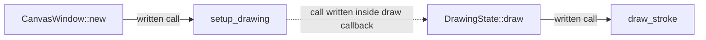

# Source reference for the reserved Sketchlayer questions

For the maintainer checking the structural experiment. This source-informed reference was
written after the first question controls, predeclared structural operations and equal-seed
text searches were saved. It is not an answer generated by the prototype or a small model.
The revision is `f52314e676ead6a50913e89a458ec34c23d509f9`; the inspected export was read-only.

## Where to add a tool

The integration spans a few places rather than a single registration interface:

- Add the variant to [Tool](</home/mpd/git-sources/sketchlayer/src/drawing.rs:5>).
- Add its toolbar button/icon and selected-state handling in
  [ToolWindow::new](</home/mpd/git-sources/sketchlayer/src/tool_window.rs:32>).
  The current highlighting match is near line 94, and the shared
  [connect_tool_button closure](</home/mpd/git-sources/sketchlayer/src/tool_window.rs:152>)
  connects a button to `DrawingState::set_tool`. Add the new button to those connections
  and to the toolbar layout, not just to the enum.
- Add its rendering behaviour to
  [DrawingState::draw_stroke](</home/mpd/git-sources/sketchlayer/src/drawing.rs:221>).
  Depending on the interaction, update `start_stroke`, `add_point` and `end_stroke` too:
  the existing Line/Circle/Rectangle tools have special multi-point handling.
- Register any new SVG resource in
  [resources.gresource.xml](</home/mpd/git-sources/sketchlayer/resources/resources.gresource.xml:1>)
  and add the asset under `resources/icons/`.

[DrawingState::set_tool](</home/mpd/git-sources/sketchlayer/src/drawing.rs:191>) changes the
selected tool. Inverse call-site inspection finds its use in the toolbar's click closure
at line 163. `Tool` itself has zero recorded same-name *calls* because enum-variant/type
references are not call expressions; that count does not mean it is unused.

## Where a main-surface border belongs

The canvas is constructed in [CanvasWindow::new](</home/mpd/git-sources/sketchlayer/src/canvas.rs:21>).
It is an undecorated, fullscreen `ApplicationWindow` with a `DrawingArea` child and an
existing `.canvas-window` CSS class. The transparent canvas CSS is installed at
[canvas.rs:40](</home/mpd/git-sources/sketchlayer/src/canvas.rs:40>). The existing
`border-color` search hit in `tool_window.rs` styles a selected toolbar button; changing
that would affect the wrong surface.

If “top window” means the canvas is the active window, start with that canvas CSS and
GTK's active/inactive state. GTK documents `GtkWindow:is-active` as the toplevel activity
property; `:backdrop` is a supported CSS state selector and border properties are supported.
A CSS-only candidate to validate on the target desktop is:

```css
.canvas-window {
    background-color: rgba(0, 0, 0, 0);
    border: 2px solid #4a86e8;
}
.canvas-window:backdrop {
    border-color: rgba(74, 134, 232, 0.25);
}
```

This is a proposed change, not an implementation or verified rendering result.
Keep border width constant across states to avoid state-dependent layout shifts.
See the official [activity property](https://docs.gtk.org/gtk4/property.Window.is-active.html),
[CSS selectors](https://docs.gtk.org/gtk4/css-overview.html) and
[border properties](https://docs.gtk.org/gtk4/css-properties.html).

The app deliberately makes its toolbar transient for the canvas in
[build_ui](</home/mpd/git-sources/sketchlayer/src/main.rs:43>). Decide whether the border
means **canvas active** or **either Sketchlayer window active**: the latter needs activity
from both windows, rather than just the canvas's backdrop state. The application-level
last-active-window lookup alone is not a global focus indicator, as the
[GTK documentation explains](https://docs.gtk.org/gtk4/method.Application.get_active_window.html).
Activity is the proposed interpretation here; arbitrary window stacking is a separate concern.

If drawing the border with Cairo instead of GTK CSS, use the
[DrawingArea callback](</home/mpd/git-sources/sketchlayer/src/canvas.rs:145>) and draw it **after**
`DrawingState::draw(cr)`. That method [clears the drawing surface](</home/mpd/git-sources/sketchlayer/src/drawing.rs:204>),
so a border painted earlier in the callback would be erased. A canvas-only UI border
should stay outside stored strokes and exported drawing content. There is no active-window
notification/backdrop handling in this frozen source; adding that behaviour requires a
separate change and target-desktop verification.

## What call-site navigation can show



The middle link is callback source containment, not immediate execution of `draw` while
`setup_drawing` runs. The prototype exposes candidate destinations and locations; confirming
GTK callback semantics and choosing focus behaviour still require source/framework knowledge.
